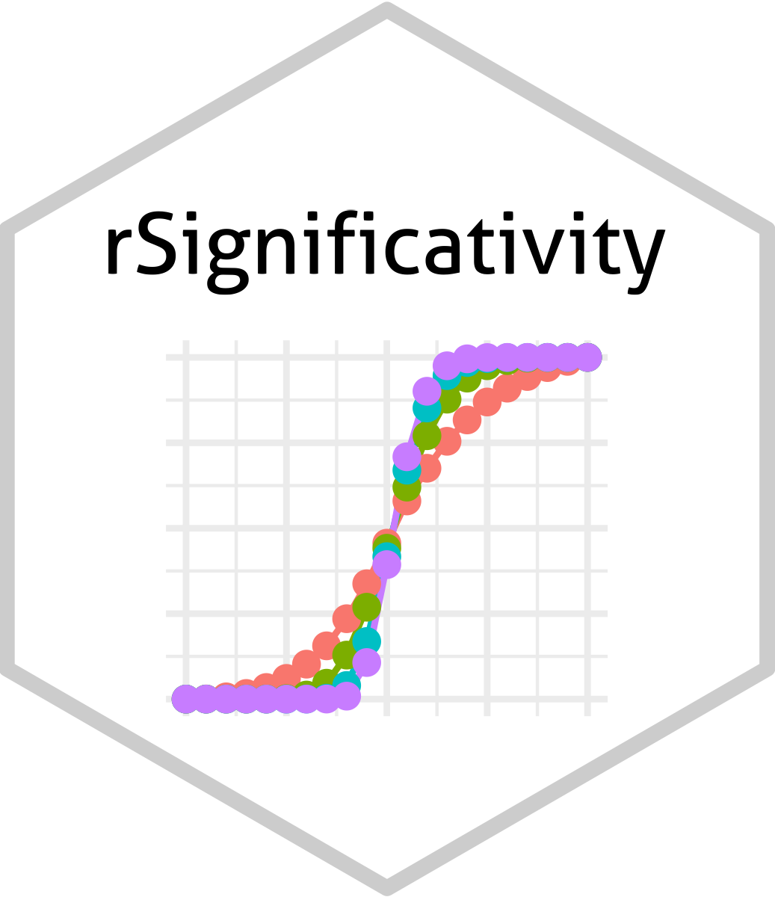

# rSignificativity <a href="albertocasagrande.github.io/rSignificativity"></a>

<!-- badges: start -->
<!--
[](https://github.com/albertocasagrande/rSignificativity/actions)
-->
[](https://github.com/albertocasagrande/rSignificativity/actions/workflows/pkgdown.yaml)
<!-- badges: end -->

`rSignificativity` is an R package that implements the $\sigma$-significativity for agreement values.

#### Help and support

## [](https://albertocasagrande.github.io/rSignificativity/)

### Installation

In order to install the development version of `rSignificativity`, you need:

* [R and Rtools](https://cran.r-project.org)

* the R package [`devtools`](https://devtools.r-lib.org)

* the [GMP library](https://gmplib.org)

* [git](https://git-scm.com/downloads)

When the requirements have been satisfied, issue the R command:

``` r
pak::pak("albertocasagrande/rSignificativity")
```

## Citation

If you use **rSignificativity** in your research, please cite:

> A. Casagrande, F. Fabris, R. Girometti, and R. Pagliarini.
> **Significativity Indices for Agreement Values.**
> *Statistics and Computing*, 35(6):197, 2025.
> [doi:10.1007/s11222-025-10728-1](https://doi.org/10.1007/s11222-025-10728-1)

> A. Casagrande and R. Pagliarini.
> **A Marginal Significativity Index for Agreement Values.**
> In *2025 IEEE International Conference on Bioinformatics and Biomedicine (BIBM)*, pp. 5392–5399, 2025.
> [doi:10.1109/BIBM66473.2025.11356859](https://doi.org/10.1109/BIBM66473.2025.11356859)

### BibTeX

```bibtex
@article{casagrande2025a,
  author  = {Casagrande, Alberto and Fabris, Francesco and Girometti, Rossano and Pagliarini, Roberto},
  title   = {Significativity Indices for Agreement Values},
  journal = {Statistics and Computing},
  volume  = {35},
  number  = {6},
  pages   = {197},
  year    = {2025},
  doi     = {10.1007/s11222-025-10728-1}
}

@inproceedings{casagrande2025b,
  author    = {Casagrande, Alberto and Pagliarini, Roberto},
  title     = {A Marginal Significativity Index for Agreement Values},
  booktitle = {2025 IEEE International Conference on Bioinformatics and Biomedicine (BIBM)},
  pages     = {5392--5399},
  year      = {2025},
  doi       = {10.1109/BIBM66473.2025.11356859}
}
```

------------------------------------------------------------------------

## Copyright and contacts

MIT License

Copyright (c) 2025-2026 Alberto Casagrande <alberto.casagrande@uniud.it>

Permission is hereby granted, free of charge, to any person obtaining a copy
of this software and associated documentation files (the "Software"), to deal
in the Software without restriction, including without limitation the rights
to use, copy, modify, merge, publish, distribute, sublicense, and/or sell
copies of the Software, and to permit persons to whom the Software is
furnished to do so, subject to the following conditions:

The above copyright notice and this permission notice shall be included in all
copies or substantial portions of the Software.

THE SOFTWARE IS PROVIDED "AS IS", WITHOUT WARRANTY OF ANY KIND, EXPRESS OR
IMPLIED, INCLUDING BUT NOT LIMITED TO THE WARRANTIES OF MERCHANTABILITY,
FITNESS FOR A PARTICULAR PURPOSE AND NONINFRINGEMENT. IN NO EVENT SHALL THE
AUTHORS OR COPYRIGHT HOLDERS BE LIABLE FOR ANY CLAIM, DAMAGES OR OTHER
LIABILITY, WHETHER IN AN ACTION OF CONTRACT, TORT OR OTHERWISE, ARISING FROM,
OUT OF OR IN CONNECTION WITH THE SOFTWARE OR THE USE OR OTHER DEALINGS IN THE
SOFTWARE.


